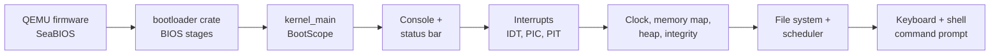
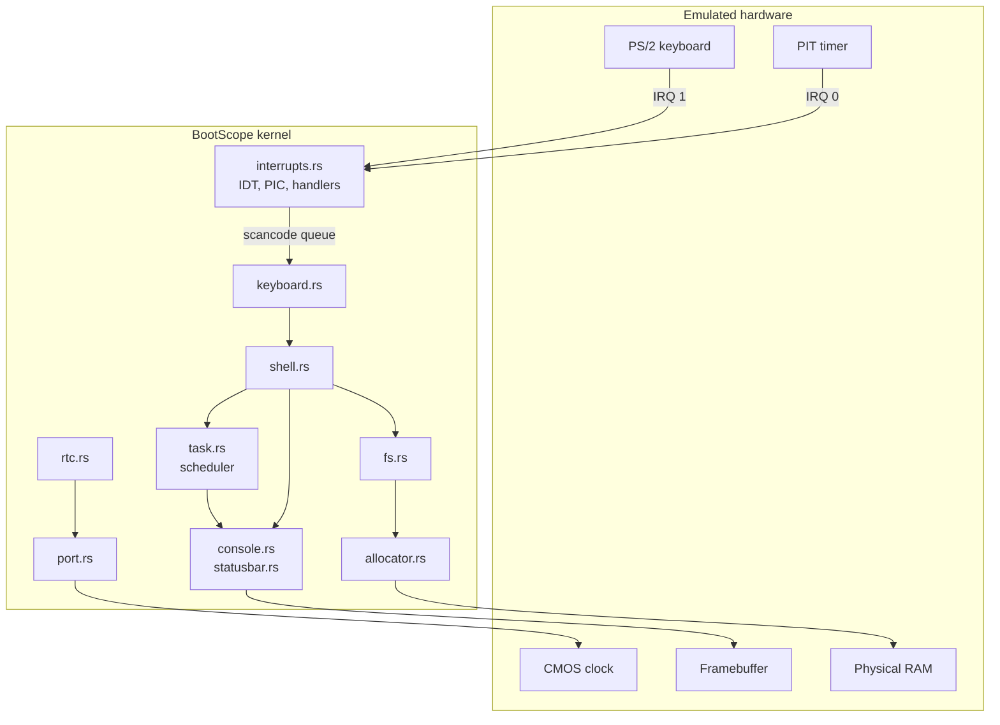

# BootScope - Architecture

## 1. Boot flow



| Stage | Whose code | What happens |
|---|---|---|
| Firmware | QEMU (SeaBIOS) | Starts the virtual PC and loads the first sector of the disk image |
| Bootloader | `bootloader` crate | Switches the CPU to 64-bit long mode, sets up page tables and the framebuffer, maps all physical memory (requested in `BOOTLOADER_CONFIG`), loads the kernel ELF and jumps to it with a `BootInfo` structure |
| Kernel | **BootScope** | Everything from `kernel_main` onwards |

BootScope does **not** implement firmware or bootloader functionality; it starts at `kernel_main`.

### Kernel boot steps (as shown on screen)

1. Bootloader handoff successful (bootloader API version)
2. Console initialized (framebuffer size)
3. Interrupts enabled (IDT loaded, PIC remapped, timer at 100 Hz)
4. Real-time clock read
5. Memory map received (regions, usable RAM)
6. Heap allocator ready
7. Kernel image measured (educational integrity demo)
8. RAM file system mounted
9. Scheduler started (background tasks)
10. Keyboard ready (interrupt-driven)
11. Command shell ready

Each `[ OK ]` line is printed only after its step has actually succeeded. If the heap cannot be
created, a `[FAIL]` line is shown and the CPU is halted.

## 2. Components



| Module | Responsibility |
|---|---|
| `main.rs` | Bootloader config, boot sequence, main loop, panic handler |
| `console.rs` | Draws text pixel by pixel; colours, scrolling (status bar stays fixed), cursor, headings |
| `statusbar.rs` | Boot progress bar; live status bar |
| `interrupts.rs` | IDT, exception handlers, PIC set-up, PIT at 100 Hz, keyboard handler, scancode ring buffer, tick counter |
| `keyboard.rs` | Scancode set 1 to characters; Shift state |
| `shell.rs` | 64-character input buffer, parsing (`command args`), 10-entry history, commands |
| `allocator.rs` | Heap from the largest usable RAM region (max 16 MiB) using `linked_list_allocator` |
| `fs.rs` | RAM file system (max 32 files, 24-character names, 4096 bytes per file) |
| `task.rs` | `Task` trait, round-robin `Scheduler`, `clock`, `cursor` and `primes` tasks |
| `sysinfo.rs` | Values collected at boot (memory map, kernel address/size, display, boot time) |
| `rtc.rs` | Reads date/time from CMOS ports `0x70`/`0x71` (BCD and 12/24-hour aware) |
| `integrity.rs` | FNV-1a hash of the kernel image (educational) |
| `power.rs` | Reboot via keyboard controller (`0xFE` to port `0x64`); QEMU power-off (`0x2000` to port `0x604`) |
| `port.rs` | Wraps the `in` / `out` instructions; the only place raw port I/O lives |
| `panic_screen.rs` | Shows panic message and location on screen, then halts |

## 3. Interrupt handling

| Vector | Source | Handler |
|---|---|---|
| 3 | Breakpoint (`int3`) | Counts it and returns (`trap` command) |
| 8 | Double fault | Panic screen |
| 13 | General protection fault | Panic screen |
| 14 | Page fault | Panic screen with faulting address (`crash yes` command) |
| 32 | IRQ 0, PIT timer, 100 Hz | Increments the tick counter |
| 33 | IRQ 1, keyboard | Reads scancode from port `0x60`, pushes it into the ring buffer |

The 8259 PIC is remapped so that IRQ 0-15 use vectors 32-47, because vectors 0-31 are reserved for
CPU exceptions. Only IRQ 0 and IRQ 1 are unmasked. Every hardware handler sends an
"end of interrupt" to the PIC.

The keyboard queue is a single-producer / single-consumer ring buffer using atomics, so the interrupt
handler never waits for a lock.

## 4. Main loop

```
loop {
    for each scancode in the queue:
        key = keyboard.handle_scancode(scancode)
        if key: shell.handle_key(key)          // may run a command
    scheduler.run_once()                       // every task gets one step
    if no task needs the CPU:
        sleep until the next interrupt (sti; hlt)
}
```

Sleeping with `hlt` means the CPU is idle when nothing happens; it wakes on the next timer tick
(every 10 ms) or key press. `sti; hlt` is executed as one step so a key press cannot be missed.

## 5. Memory

- The bootloader's **memory map** lists physical regions as Usable, Bootloader (kernel, page tables,
  boot info) or Reserved (firmware). `mem` prints it.
- All physical memory is mapped at a virtual offset chosen by the bootloader.
- The **heap** takes up to 16 MiB of the largest usable region. `mem`, `info` and the status bar show
  real allocated/free values from the allocator.
- The kernel does not manage page tables itself.

## 6. Design decisions

| Decision | Reason |
|---|---|
| `bootloader` crate instead of own bootloader | Maintained, works with current nightly Rust; writing a bootloader is outside course scope |
| BIOS image | Simplest set-up in QEMU on Windows (no UEFI firmware files needed) |
| Framebuffer + bitmap font instead of VGA text mode | The bootloader provides a framebuffer; VGA text mode is not available in this set-up |
| Cooperative scheduler | Demonstrates scheduling without context switching, which needs assembly-level stack switching |
| RAM file system | Demonstrates a file system (names, create/read/write/delete) without a disk driver |
| Fixed limits (64-char input, 32 files, 64-entry key queue) | Prevent overflow; behaviour is predictable |
| `unsafe` only in small, commented functions | Port I/O, raw memory reads, heap init, `hlt`; everything else is safe Rust |

## 7. Safety and `unsafe`

`unsafe` blocks are limited to: port I/O (`port.rs`), the `hlt` instruction, heap initialization,
reading the kernel image for the integrity check, PIC/PIT programming, the panic screen taking over the
framebuffer, and the deliberate fault in `crash yes`. Each has a `SAFETY:` comment explaining why it is
acceptable.
